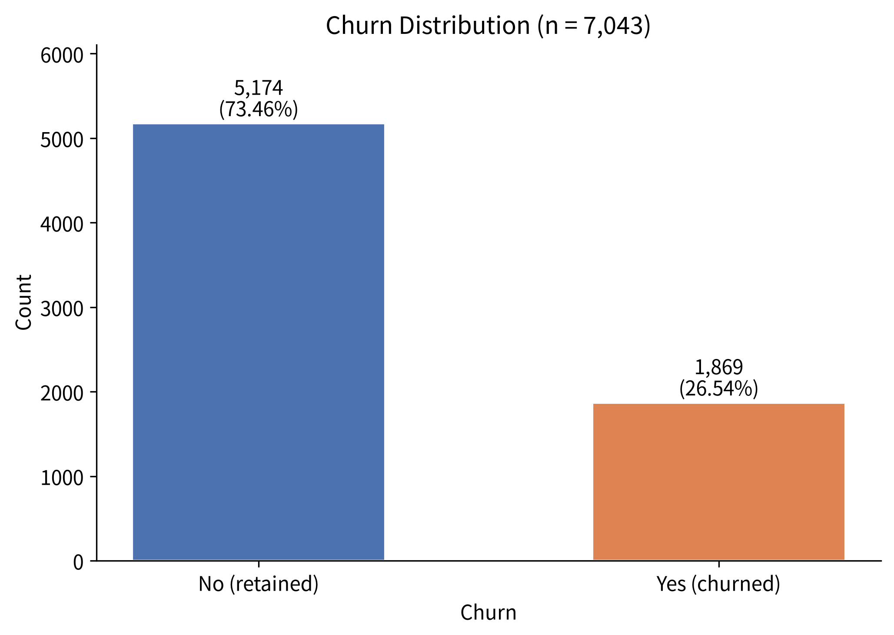
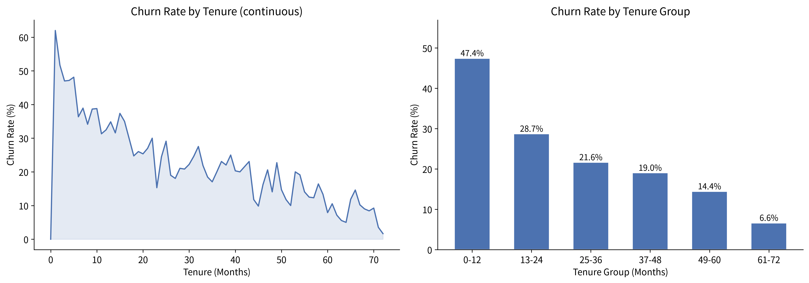
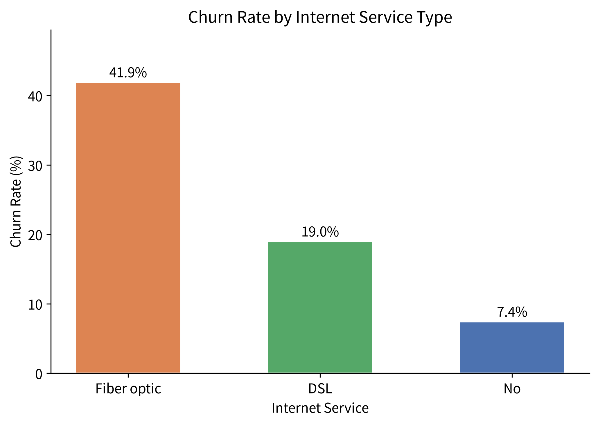
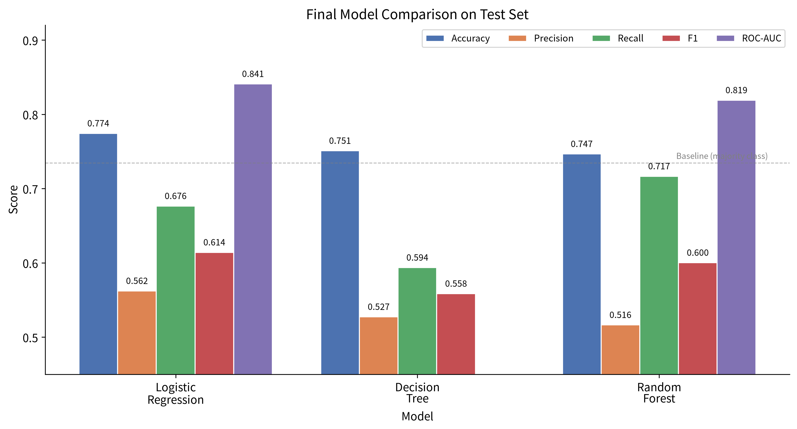
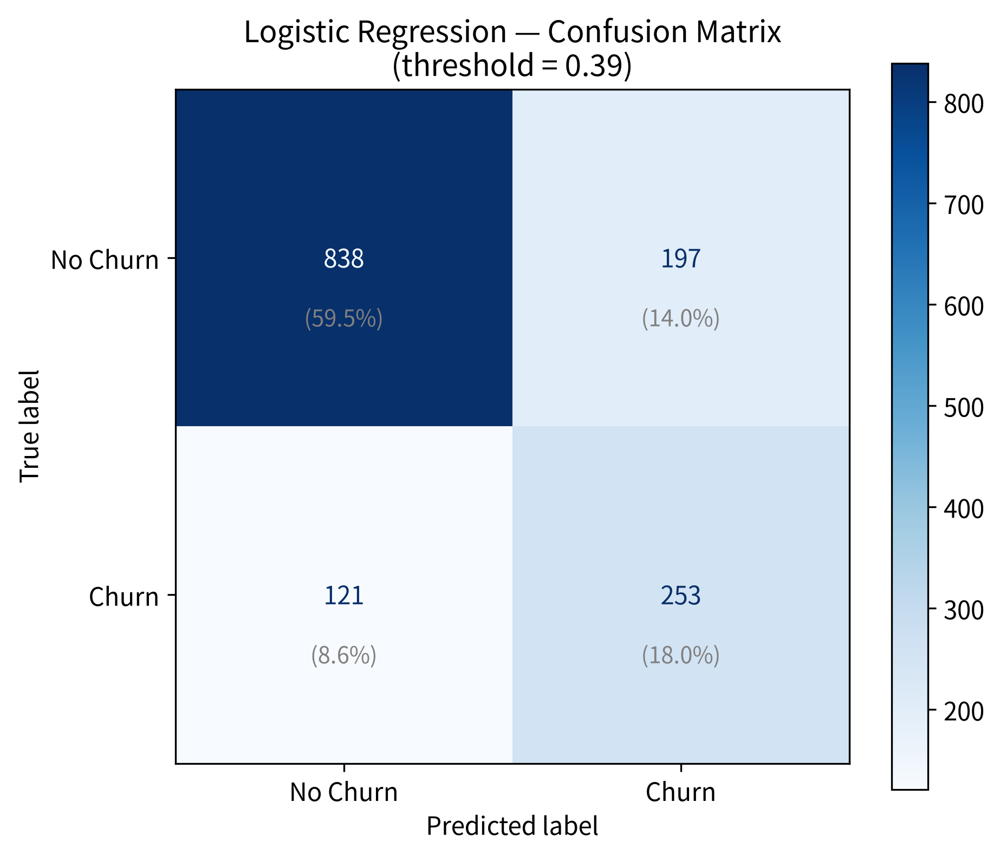
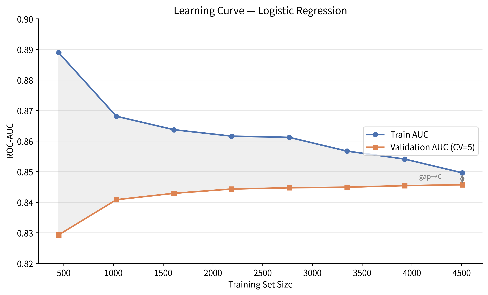

# 《电信用户流失预测》项目最终报告

> **项目状态：已归档（Archive）**
> 本报告为项目最终版，不再新增模型、调参或特征工程。

---

## 一、项目定位

**任务：** 根据电信用户的基本属性、服务使用情况、合同信息和费用信息，预测用户是否会流失。

**数据：** 7043 条用户记录，21 个字段；其中 `Churn` 为预测目标。

| 指标 | 值 |
|---|---|
| 总样本数 | 7,043 |
| 字段数 | 21（含目标变量） |
| 未流失（No） | 5,174（73.46%） |
| 流失（Yes） | 1,869（26.54%） |
| 重复行 | 0 |
| 重复 customerID | 0 |
| TotalCharges 空值 | 11（对应 tenure=0，转为数值后填充为 0） |



**训练集 / 测试集划分：**

| 集合 | 样本数 | 划分方式 |
|---|---|---|
| 训练集 | 5,634 | 按 Churn 分层抽样，`random_state=42` |
| 测试集 | 1,409 | 按 Churn 分层抽样，`random_state=42` |

---

## 二、研究问题

整个项目围绕三个问题展开：

### 问题 1：用户流失是否能够被有效预测？

首先建立多数类 Baseline。如果永远预测"不流失"，准确率已经可以达到 **73.46%**。

> 仅仅追求 Accuracy 没有意义。

真正需要关注的是：

- Precision（精确率）
- Recall（召回率）
- F1-score
- ROC-AUC

尤其是流失用户的 Recall。

### 问题 2：不同模型的泛化能力有什么区别？

比较三种模型：

1. **Logistic Regression** — 线性基准模型，可解释性强
2. **Decision Tree** — 非线性分段决策，研究过拟合现象
3. **Random Forest** — Bagging 集成，研究方差降低效果

通过交叉验证、验证集和最终测试集进行比较。

### 问题 3：模型为什么做出这样的预测？

最终不仅给出一个分数，还进一步分析：

- 模型系数（Logistic Regression）
- False Positive / False Negative 错误样本
- 分类阈值变化的影响
- 学习曲线（Learning Curve）

从而回答：**模型到底学到了什么，以及哪些用户最难预测？**

---

## 三、数据分析结论（EDA）

EDA 中最重要的结果不是"画了多少图"，而是发现了几个稳定信号。

### 1. Contract（合同类型）

合同类型与流失存在明显关系。尤其是 **Month-to-month 用户的流失风险明显高于长期合同用户**。


这也是后续 Logistic Regression 中非常重要的变量。

### 2. Tenure（在网时长）

用户使用服务的时间越长，整体上越不容易流失。尤其是 **新用户 / 短 tenure 用户更加容易流失**。



这与后续模型结果一致。

### 3. InternetService（互联网服务类型）

不同互联网服务类型之间存在明显差异。其中 **Fiber optic 用户表现出了更高的流失风险**。



这一信号在最终 Logistic Regression 系数中仍然非常明显。

---

## 四、模型设计

### 4.1 Logistic Regression

这是本项目最重要的基准模型。

**模型形式：**

```
z = wᵀx + b
p = sigmoid(z)
```

通过 **最大似然 → 交叉熵损失 → 梯度下降** 学习参数。

项目中还手写实现了 NumPy 版本 Logistic Regression（`MyLogisiticRegression` 类），因此不是简单调用 sklearn。

**预处理：**

- 数值变量：`StandardScaler`
- 类别变量：`OneHotEncoder`
- `Pipeline` + `ColumnTransformer`

这一步非常重要，因为它把 **数据预处理 → 特征变换 → 模型** 统一到了一个 Pipeline 中，避免训练集和测试集处理不一致。

**正则化实验：** 测试了 L1 / L2 正则化，以及不同 C 值（0.01, 0.1, 1, 10, 100），最终选择 `C=100, penalty="l2"`。

---

## 五、Decision Tree

Decision Tree 用于研究：**如果允许模型进行非线性、分段式决策，会不会明显超过 Logistic Regression？**

项目中学习并实现了：

- Entropy（信息熵）
- Information Gain（信息增益）
- 连续变量最佳切分点（手写 `best_split_numeric`）

然后进行了不同树深度实验：

| depth | train F1 | test F1 |
|---:|---:|---:|
| 2 | 0.587 | 0.587 |
| 5 | 0.593 | 0.570 |
| 8 | 0.678 | 0.562 |
| 10 | 0.746 | 0.537 |
| 15 | 0.903 | 0.512 |
| 20 | 0.973 | 0.505 |

这给出了一个非常清楚的机器学习现象：

> 随着树复杂度增加，训练集表现持续提高，但泛化性能反而下降。

即 **过拟合（Overfitting）**。

最终选择：

```
criterion = entropy
max_depth = 2
```

**测试集结果：**

| 指标 | 值 |
|---|---:|
| Accuracy | 0.7509 |
| Precision | 0.5273 |
| Recall | 0.5936 |
| F1 | 0.5585 |

Decision Tree 没有超过 Logistic Regression。

---

## 六、Random Forest

Random Forest 进一步研究：**能否通过 Bagging + 随机特征选择降低单棵决策树的方差？**

实验包括：

- `n_estimators`（树的数量）
- `max_features`（每棵树随机选择特征比例）
- OOB（Out-of-Bag）评估
- 阈值调整

最终参数：

```
n_estimators = 200
max_features = 0.5
criterion = entropy
```

**默认阈值 0.5：**

| 指标 | 值 |
|---|---:|
| F1 | 0.5677 |
| ROC-AUC | 0.8190 |

进一步通过验证集寻找分类阈值：

```
threshold = 0.30
```

**最终测试集（threshold=0.30）：**

| 指标 | 值 |
|---|---:|
| Accuracy | 0.7466 |
| Precision | 0.5164 |
| Recall | 0.7166 |
| F1 | 0.6002 |
| ROC-AUC | 0.8190 |

Random Forest 有一个非常有意义的结果：

> 它比 Logistic Regression 找到了更多真正的流失用户（Recall 更高），但同时产生了更多误报（Precision 更低）。

---

## 七、最终模型比较

这是项目最重要的一张表：



| 模型 | Accuracy | Precision | Recall | F1 | ROC-AUC |
|---|---:|---:|---:|---:|---:|
| **Logistic Regression** | **0.7743** | **0.5622** | 0.6765 | **0.6141** | **0.8409** |
| Decision Tree | 0.7509 | 0.5273 | 0.5936 | 0.5585 | — |
| Random Forest | 0.7466 | 0.5164 | **0.7166** | 0.6002 | 0.8190 |

### 最终选择：Logistic Regression

原因不是"逻辑回归最简单"，而是：

> 在当前数据、特征和实验设计下，Logistic Regression 获得了最高的 F1 和 ROC-AUC，同时 Precision 也优于 Random Forest。

Random Forest 的 Recall 更高，但代价是大量 False Positive。

> **如果目标是综合预测质量，选择 Logistic Regression；如果业务极度重视"尽可能抓住流失用户"，Random Forest + 较低阈值也具有实际价值。**

---

## 八、最终阈值为什么不是 0.5？

默认规则 `p >= 0.5 → Churn` 并不是机器学习的"真理"。

项目使用训练数据内部划分出的 validation set（训练集的 20%，分层抽样）搜索阈值：

```
threshold = 0.39
```

然后：

> 锁定阈值 → 用完整训练集重新训练 → 最后一次使用测试集评估。

因此测试集没有参与阈值选择，这是一个比较规范的实验流程，避免了数据泄露。

---

## 九、最终 Logistic Regression 结果

**最终实际运行结果：**

```
Threshold : 0.39
Accuracy  : 0.7743
Precision : 0.5622
Recall    : 0.6765
F1        : 0.6141
ROC-AUC   : 0.8409
```

**混淆矩阵：**



```
                 Predicted
                 No     Yes

Actual No       838    197
Actual Yes      121    253
```

| 指标 | 值 | 含义 |
|---|---:|---|
| TN | 838 | 正确预测为未流失 |
| FP | 197 | 误报（实际未流失，预测流失） |
| FN | 121 | 漏报（实际流失，预测未流失） |
| TP | 253 | 正确预测为流失 |

测试集中 374 个真实流失用户，模型识别出了 253 个：

```
Recall = 253 / 374 = 67.65%
```

---

## 十、最终模型解释

Logistic Regression 最大的价值之一就是可解释性。

### 与更高流失风险正相关的特征（系数为正）

| 特征 | 系数 |
|---|---:|
| InternetService_Fiber optic | 1.551 |
| StreamingMovies_Yes | 0.637 |
| StreamingTV_Yes | 0.636 |
| TotalCharges | 0.598 |
| Contract_Month-to-month | 0.528 |
| MultipleLines_Yes | 0.418 |

### 与更低流失风险相关的特征（系数为负）

| 特征 | 系数 |
|---|---:|
| MonthlyCharges | -2.522 |
| InternetService_DSL | -1.329 |
| tenure | -1.319 |
| Contract_Two year | -0.843 |

### ⚠️ 重要提醒：系数代表条件关联，不是因果关系

例如 `MonthlyCharges` 在多变量模型中表现出负系数，**不能因此直接写"月费越高，流失率越低"**。因为 MonthlyCharges 与 InternetService、Streaming 服务等变量之间存在相关关系。

同样，`TotalCharges ↑` 与 `tenure ↓` 同时出现，也说明变量之间存在明显的结构性相关。

因此报告统一使用：

> "与更高/更低的预测流失风险相关"

而不使用"导致流失"。

---

## 十一、错误分析

最终模型的错误不是随机的。

### False Negative（漏报，FN = 121）

这些用户真实会流失，但是模型没有识别出来。整体表现为：

- tenure 相对更长
- 部分拥有长期合同
- 服务组合更加复杂
- 与正常用户存在较大重叠

这说明：**当前特征空间并不能完全区分所有流失用户。**

### False Positive（误报，FP = 197）

模型认为他们可能流失，但实际上没有流失。典型特征包括：

- tenure 较短
- MonthlyCharges 较高
- Month-to-month 合同
- Fiber optic 服务
- Electronic check 支付方式

这里特别有意思：

> 这些并不是"垃圾预测"，而是真正具有流失风险特征的人群，只是他们最终没有流失。

所以模型并不是简单地"判断错了"，而是在一个存在大量类别重叠的数据空间里进行概率判断。

---

## 十二、Learning Curve（学习曲线）

最终还进行了 Logistic Regression 的 Learning Curve（5 折交叉验证，ROC-AUC）：



| Train size | Train AUC | Validation AUC |
|---:|---:|---:|
| 450 | 0.8889 | 0.8293 |
| 1,030 | 0.8681 | 0.8408 |
| 1,609 | 0.8637 | 0.8429 |
| 2,189 | 0.8616 | 0.8443 |
| 2,768 | 0.8612 | 0.8447 |
| 3,348 | 0.8567 | 0.8449 |
| 3,927 | 0.8541 | 0.8454 |
| 4,507 | 0.8496 | 0.8457 |

可以观察到：

> 随训练数据增加，训练 AUC 与验证 AUC 逐渐靠近，验证集 AUC 后期逐渐趋于平台。

因此：

> 单纯继续增加同分布数据，收益可能逐渐降低；下一步如果希望显著提高性能，更值得考虑新的信息、特征表达方式或更合适的模型，而不是无限增加样本。

---

## 十三、最终结论

### 结论 1：电信用户流失具有明显的结构性规律

其中 `Contract`、`tenure`、`InternetService`、`MonthlyCharges`、`PaymentMethod` 等变量提供了较强的预测信号。

### 结论 2：Decision Tree 很容易产生过拟合

树深度增加后，训练性能不断提升，但测试性能下降。这是典型的高方差问题。

### 结论 3：Random Forest 能够改善对部分流失用户的识别能力

通过降低分类阈值，Recall 可以达到 71.66%，但同时产生更多误报。

### 结论 4：Logistic Regression 是最终最优模型

在本项目当前数据和实验设置下，Logistic Regression 取得：

```
F1      = 0.6141
ROC-AUC = 0.8409
Recall  = 0.6765
```

### 结论 5：模型性能存在明确上限

部分用户的特征在流失与未流失类别之间高度重叠，因此即使使用更复杂模型，也不能保证所有用户都能被正确分类。

---

## 十四、项目局限

报告里必须主动写局限，而不是假装模型很好。

### 1. 数据规模有限

7,043 条样本对于教学项目足够，但对于真实商业预测系统仍然有限。

### 2. 特征主要是静态用户属性

缺少：

- 用户历史行为序列
- 投诉记录
- 客服交互
- 网络质量
- 套餐变更
- 时间序列消费行为

因此模型能够学习的信息有限。

### 3. 数据是静态数据集

无法验证模型在真实时间环境下的长期稳定性。

### 4. 当前模型没有进行概率校准

因此预测概率更适合作为排序/分类依据，而不能直接理解为严格意义上的真实流失概率。

### 5. 当前阈值优化针对 F1

如果真实业务成本不同（例如获取一个流失用户的成本 vs 误报一个用户的成本），最佳阈值也应该不同。

---

## 十五、项目目录

```
Telecom-Churn-Prediction/
│
├── data/
│   └── data.csv                  # 原始数据集（7,043 条，21 字段）
│
├── notebooks/
│   └── 电信流失用户预测.ipynb      # 完整实验 Notebook
│
├── figures/
│   ├── churn_distribution.png    # 流失分布
│   ├── churn_by_contract.png     # 合同类型 vs 流失
│   ├── churn_by_internet_service.png  # 互联网服务 vs 流失
│   ├── tenure_vs_churn.png       # 在网时长 vs 流失
│   ├── model_comparison.png      # 三模型指标对比
│   ├── confusion_matrix.png      # 最终 LR 混淆矩阵
│   ├── learning_curve.png        # LR 学习曲线
│   └── generate_figures.py       # 图表复现脚本
│
├── results/
│   ├── final_results.csv         # 模型指标汇总
│   └── final_report.md           # 本报告
│
├── src/
│   └── README.md                 # src 目录说明
│
├── .gitignore
└── README.md                     # 项目首页
```

---

## 十六、知识体系覆盖

本项目完整覆盖了以下经典机器学习知识点：

```
数据清洗
  ↓
EDA（探索性数据分析）
  ↓
Baseline（多数类基准）
  ↓
Logistic Regression（含手写 NumPy 实现）
  ↓
损失函数 / 梯度下降
  ↓
正则化（L1 / L2）
  ↓
交叉验证
  ↓
Pipeline + ColumnTransformer
  ↓
Decision Tree（含手写信息增益/切分点）
  ↓
过拟合分析
  ↓
Bagging
  ↓
Random Forest
  ↓
阈值优化（验证集搜索，避免数据泄露）
  ↓
错误分析（FP / FN）
  ↓
Learning Curve
  ↓
模型可解释性（系数分析）
  ↓
最终报告
```

---

*报告生成时间：2026-10-08*
*项目状态：已归档，不再修改实验代码与参数。*
